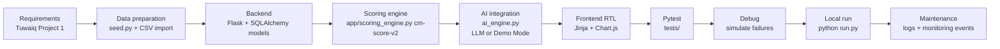
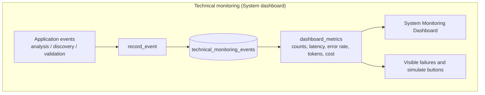

# Technical diagrams (implemented system)

These diagrams match the running Flask + SQLite application, not a conceptual future architecture.

## Development Flow

Lifecycle actually used:

1. Read the course requirements (product + monitoring + evaluation).
2. Create a local catalogue of listed company identities referenced to the Saudi Exchange issuer directory; leave financial fields blank until official data is sourced.
3. Implement models, scoring, routes, templates.
4. Wire LLM via env vars with deterministic fallback.
5. Add pytest coverage for scores, discovery, and technical monitoring.
6. Run locally, fix failures, and keep SQLite file in the instance path. Startup seeds the company catalogue and does not fabricate technical telemetry.

## Monitoring Flow

The implemented monitoring flow covers technical application events only.
